# M.Y HRMS — Core database ERD

Scope: core tables only (tenancy, identity, access, organisation, employees, documents, activity log).
Payroll, leave, attendance and contractors come later.

Conventions:

- All primary keys are ULIDs (`char(26)`).
- Every tenant table has an indexed `company_id`; composite unique keys start with `company_id`.
- Effective-dated history uses `valid_from` (inclusive) / `valid_to` (exclusive, `NULL` = current). Past rows are never overwritten.
- Only `employees` uses soft deletes.
- `activity_log` is append-only (model guard + MySQL triggers).
- Solid lines are foreign keys; dotted lines are polymorphic links validated by the application.
- Sensitive data (tax IDs, bank details) is not in core. It will live in separate, encrypted, payroll-permission tables that reference `employees.id` (e.g. `employee_tax_identifiers`, `employee_bank_accounts`).
- Laravel framework tables (`sessions`, `password_reset_tokens`, `personal_access_tokens`, cache, jobs) are omitted; only their user references change to ULID.

```mermaid
erDiagram
    companies ||--|| company_settings : has
    companies ||--o{ company_payroll_countries : employs_in
    companies ||--o{ company_users : has_members
    companies ||--o{ roles : defines
    companies ||--o{ invitations : sends
    companies ||--o{ locations : has
    companies ||--o{ departments : has
    companies ||--o{ teams : has
    companies ||--o{ employees : employs
    companies ||--o{ documents : owns
    companies |o--o{ activity_log : records

    users ||--o{ company_users : belongs_to
    users ||--o{ login_attempts : makes
    users |o--o{ employees : "self-service login"
    users |o--o{ activity_log : actor
    users |o--o{ invitations : "invited_by / accepted_user"

    company_users ||--o{ role_assignments : holds
    roles ||--o{ role_assignments : granted_as
    roles ||--o{ permission_role : has
    permissions ||--o{ permission_role : in
    roles ||--o{ invitations : offers

    departments |o--o{ departments : parent
    departments |o--o{ teams : contains

    employees ||--o{ employee_job_history : job
    employees ||--o{ employee_manager_history : reports_to
    employees ||--o{ employee_location_history : works_at
    employees ||--o{ employee_status_history : status
    employees |o--o{ employee_manager_history : "is manager in"
    departments |o--o{ employee_job_history : in
    teams |o--o{ employee_job_history : in
    locations ||--o{ employee_location_history : at
    employees |o--o{ invitations : "invites to self-service"

    teams |o..o{ role_assignments : "scope: team"
    locations |o..o{ role_assignments : "scope: location"
    employees |o..o{ role_assignments : "scope: reporting_line"
    teams |o..o{ invitations : scope
    locations |o..o{ invitations : scope
    employees |o..o{ documents : documentable
    companies |o..o{ documents : documentable

    companies {
        ulid id PK
        string name
        string legal_name
        char2 country_code
        string contact_email
        string status "active|suspended"
    }
    company_settings {
        ulid id PK
        ulid company_id FK,UK
        string timezone
        char3 currency_code
        json work_days
        tinyint week_start_day
        string date_format
        string locale
    }
    company_payroll_countries {
        ulid id PK
        ulid company_id FK
        char2 country_code "UK(company_id,country_code)"
        bool is_primary
    }
    users {
        ulid id PK
        string email UK
        string password
        string status
        string platform_role "nullable: ops|support"
        timestamp last_login_at
    }
    login_attempts {
        ulid id PK
        ulid user_id FK "nullable"
        string email
        bool succeeded
        string failure_reason
        string ip_address
        timestamp created_at
    }
    company_users {
        ulid id PK
        ulid company_id FK
        ulid user_id FK "UK(company_id,user_id)"
        string status "active|suspended|removed"
        timestamp joined_at
        timestamp suspended_at
        timestamp removed_at
    }
    roles {
        ulid id PK
        ulid company_id FK
        string key "UK(company_id,key)"
        string name
        bool is_system
    }
    permissions {
        ulid id PK
        string key UK
        string group
        bool is_sensitive
    }
    permission_role {
        ulid company_id FK
        ulid role_id FK
        ulid permission_id FK "PK(company_id,role_id,permission_id)"
    }
    role_assignments {
        ulid id PK
        ulid company_id FK
        ulid company_user_id FK
        ulid role_id FK
        string scope_type "company|team|location|reporting_line"
        ulid scope_id "nullable, polymorphic"
        bool include_indirect
        ulid assigned_by FK
        timestamp revoked_at
        ulid revoked_by FK
        string active_key "generated; UK(company_id,active_key) while not revoked"
    }
    invitations {
        ulid id PK
        ulid company_id FK
        string email
        string token_hash UK
        ulid role_id FK
        string scope_type
        ulid scope_id
        ulid employee_id FK "nullable"
        ulid invited_by FK
        string status "pending|accepted|revoked|expired"
        timestamp expires_at
        ulid accepted_user_id FK
        string pending_email "generated; UK(company_id,pending_email)"
    }
    locations {
        ulid id PK
        ulid company_id FK
        string code "UK(company_id,code)"
        string name
        char2 country_code
        string timezone "nullable override"
        bool is_active
    }
    departments {
        ulid id PK
        ulid company_id FK
        ulid parent_id FK "nullable"
        string name "UK(company_id,name)"
        string code
        bool is_active
    }
    teams {
        ulid id PK
        ulid company_id FK
        ulid department_id FK "nullable"
        string name "UK(company_id,name)"
        bool is_active
    }
    employees {
        ulid id PK
        ulid company_id FK
        ulid user_id FK "nullable, UK(company_id,user_id)"
        string employee_number "UK(company_id,employee_number)"
        string first_name
        string last_name
        string preferred_name
        string work_email
        date start_date
        date end_date
        string current_job_title "denormalised from history"
        ulid current_department_id FK
        ulid current_team_id FK
        ulid current_manager_id FK
        ulid current_location_id FK
        string current_status
        timestamp deleted_at "soft delete"
    }
    employee_job_history {
        ulid id PK
        ulid company_id FK
        ulid employee_id FK
        string job_title
        ulid department_id FK
        ulid team_id FK
        string employment_type
        date valid_from "UK(company_id,employee_id,valid_from)"
        date valid_to "exclusive, null=current"
        bool is_current "generated; one current row"
        ulid changed_by FK
    }
    employee_manager_history {
        ulid id PK
        ulid company_id FK
        ulid employee_id FK
        ulid manager_employee_id FK
        date valid_from
        date valid_to
        bool is_current
        ulid changed_by FK
    }
    employee_location_history {
        ulid id PK
        ulid company_id FK
        ulid employee_id FK
        ulid location_id FK
        string work_arrangement "onsite|remote|hybrid"
        date valid_from
        date valid_to
        bool is_current
        ulid changed_by FK
    }
    employee_status_history {
        ulid id PK
        ulid company_id FK
        ulid employee_id FK
        string status "invited|onboarding|active|on_leave|ended"
        date valid_from
        date valid_to
        bool is_current
        string reason
        ulid changed_by FK
    }
    documents {
        ulid id PK
        ulid company_id FK
        string documentable_type
        ulid documentable_id
        string category
        string title
        string disk
        string path
        string mime_type
        bigint size_bytes
        string visibility "employee|hr|payroll"
        ulid uploaded_by FK
    }
    activity_log {
        ulid id PK
        ulid company_id FK "nullable"
        ulid actor_user_id FK "nullable"
        string action
        string subject_type
        ulid subject_id
        string description
        json properties "sensitive values masked"
        string ip_address
        timestamp created_at "no updated_at"
    }
```

